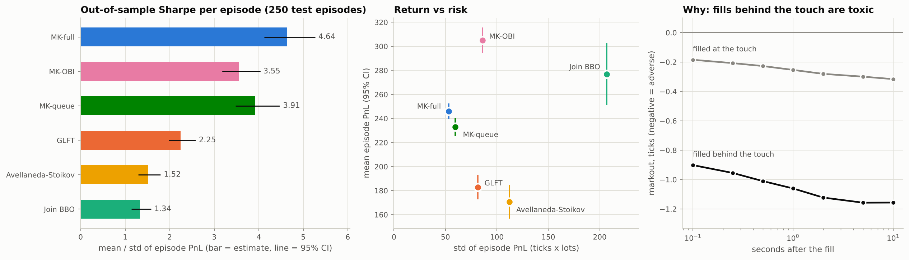
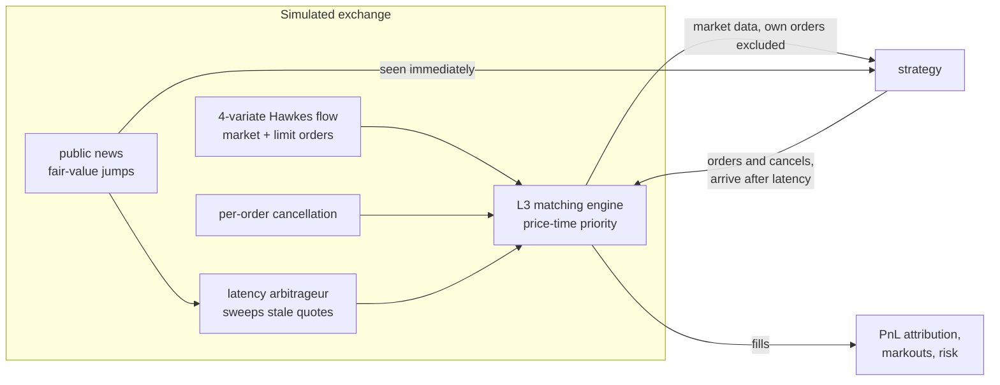

# QuoteLab

**Market making under adverse selection: a Hawkes-driven limit order book simulator, optimal-quoting
models, and an out-of-sample evaluation with proper statistics. Built from scratch in Python.**



Textbook market-making models (Avellaneda-Stoikov, Guéant-Lehalle-Fernandez-Tapia) assume your fills
are random draws. They are not: a passive order gets filled exactly when a market order arrives at its
price, and market orders cluster. In this simulated large-tick market an order filled one tick behind
the touch has lost 0.9 ticks within 0.1 s, against 0.19 for an order filled at the touch. QuoteLab builds the market, learns its order flow,
and shows that **valuing every candidate quote by the expected markout of a fill there** (queue
position, book imbalance and Hawkes order-flow forecasts) **roughly doubles the out-of-sample Sharpe ratio of the GLFT market maker, from 2.25 to 4.64 over 250 held-out episodes**, and keeps it profitable when the market turns more toxic.

## Results on held-out data

<!-- BEGIN table:test_compact -->
| Strategy | Sharpe per episode [95% CI] | Mean PnL [95% CI] | Std PnL | 5th pct PnL | Mean max drawdown | Mean abs inventory |
| :--- | ---: | ---: | ---: | ---: | ---: | ---: |
| GLFT + markouts (queue, OBI, Hawkes) | **4.64** [4.13, 5.26] | 246.0 [239.5, 252.6] | 53.1 | 150 | 40 | 0.60 |
| GLFT + markouts (queue, OBI) | 3.55 [3.19, 4.02] | 304.9 [294.3, 315.7] | 85.9 | 129 | 68 | 1.35 |
| GLFT + markouts (queue) | 3.91 [3.49, 4.47] | 233.0 [225.6, 240.5] | 59.6 | 131 | 49 | 0.70 |
| GLFT | 2.25 [1.99, 2.58] | 182.9 [172.8, 193.0] | 81.4 | 27 | 74 | 1.04 |
| Avellaneda-Stoikov | 1.52 [1.30, 1.79] | 170.5 [156.7, 184.5] | 112.3 | -10 | 95 | 1.66 |
| Join BBO | 1.34 [1.14, 1.57] | 276.8 [251.0, 302.6] | 206.9 | -57 | 164 | 5.27 |
<!-- END table:test_compact -->

*250 test episodes of 30 minutes, never used for any estimation or tuning; every strategy trades the
same event streams (common random numbers). PnL in ticks x lots. The three "GLFT + markouts" rows are
GLFT's inventory control with the fill-conditional markout model, pricing queue position only
(MK-queue), plus book imbalance (MK-OBI), plus Hawkes flow forecasts (MK-full, the variant selected on
validation data). Each family's risk aversion was chosen on validation data.*

What the numbers say:

1. **Pricing the fill, not the mid, is the big win.** The markout-aware strategy selected on validation data (MK-full) has an out-of-sample Sharpe ratio of 4.64 per episode, against 2.25 for GLFT. It makes 63 ticks more per episode (95% CI 56 to 70, better in 90% of paired episodes), has about half the drawdown, and lost money in none of the 250 test episodes. It trades less (1,030 fills against 1,515) but each lot keeps a 5-second realised spread of 0.25 ticks instead of 0.15. The cost is message traffic: 8.8 orders and cancels per fill, against 2.8 for GLFT.
2. **Each layer of the markout model pays, in a different currency.** Holding the risk aversion fixed and adding one layer at a time on the same 250 test episodes: pricing queue position adds 50 ticks per episode and 1.66 of Sharpe; book imbalance adds 11.5 ticks; the Hawkes flow forecast adds no mean PnL but cuts risk (fewer, better-timed fills, a fifth less drawdown), raising Sharpe by 0.63 (95% CI 0.32 to 0.98).
3. **Naive quoting earns spread but carries the risk.** Join BBO's mean PnL (277) rivals the markout strategies', but it carries 5.3 lots of inventory on average, four times MK-full's PnL volatility and a losing episode in every thirteen: Sharpe 1.34. Avellaneda-Stoikov (1.52) trails GLFT because its inventory penalty fades as the close approaches; its average inventory climbs from 0.7 lots in the first five minutes to 4.3 in the last five.
4. **Latency is a race against arbitrageurs, with a twist.** From 0.5 ms to 100 ms of order-entry latency, the lots MK-full loses to the news arbitrageur rise from 6 to 65 per episode and its PnL falls steadily from 255 to 220. GLFT's PnL instead *rises* above 10 ms: being slow keeps it out of the book right after the price moves, when fills are most toxic. The markout model provides that protection on purpose, so for it latency is a pure cost.
5. **It survives a regime change it was not calibrated for.** When market orders become a third more self-exciting and nothing is recalibrated, GLFT loses 508 ticks per episode and Join BBO 327, while MK-full stays profitable (+40).

Full write-up: [docs/RESEARCH_REPORT.md](docs/RESEARCH_REPORT.md).

## What is inside

| Component | Highlights |
|---|---|
| **Matching engine** (`book.py`) | L3 book, price-time priority, O(1) cancel, post-only and IOC orders. Fuzz-tested against a brute-force reference book. |
| **Order flow** (`market.py`, `hawkes.py`) | 4-variate Hawkes process (market and limit orders, buys and sells) with a two-time-scale kernel; zero-intelligence price placement; per-order cancellation hazard; public news and latency arbitrageurs who sweep stale quotes. |
| **Hawkes estimation** (`hawkes.py`) | Exact O(N) likelihood (no per-event Python loop), concave in the excitation parameters: EM warm start + projected Newton, decays by profile likelihood. Model selection by BIC, goodness of fit by the time-rescaling theorem, closed-form conditional forecasts via a matrix exponential. Exact simulation by the cluster representation, cross-checked against Ogata thinning. |
| **Backtester** (`simulator.py`) | Event-driven merge of five streams; order-entry latency; queue position emerges from the FIFO book; own orders excluded from the strategy's view; exact PnL attribution (spread capture + inventory PnL - fees, tested to 1e-6). |
| **Strategies** (`strategies.py`) | Join-the-touch, Avellaneda-Stoikov, GLFT (closed form and exact eigenvector solution), and markout-aware GLFT. Tick-constrained quoting by maximising the HJB Hamiltonian over feasible ticks; a queue-priority premium; quote protection on news. |
| **Calibration** (`calibration.py`) | Volatility, fill intensity measured with probe quotes, Newey-West regressions for mid-price predictability, fill-level markout regressions with episode-clustered errors. |
| **Evaluation** (`analytics.py`, `experiments/`) | Train / validation / test seed sets; paired bootstrap CIs and t-tests with Holm correction; ablations; latency sweep; regime stress tests. |

## How it works



The markout-aware quote for a candidate bid price *p*, with mid *m*, inventory *q* and state *x*:

$$H(p) = A e^{-k\delta}\,\frac{1 - e^{-\gamma\,(\delta + M(p, x) - \eta(q))}}{\gamma},\qquad \delta = m - p,$$

where $Ae^{-k\delta}$ is the calibrated fill intensity, $\eta(q)$ is GLFT's inventory term and
$M(p, x)$ is the expected markout of a fill at *p*, depending on whether *p* is at or behind the
touch, on book imbalance and on Hawkes forecasts of the market orders about to arrive. Plain GLFT is
$M \equiv 0$. The strategy quotes the best of a few candidate ticks and withdraws when none has
$H > 0$. Derivations are in [docs/MATHEMATICS.md](docs/MATHEMATICS.md).

## Quick start

```bash
pip install -e ".[dev]"      # numpy, scipy; matplotlib and pytest for the extras
pytest                        # 100 tests, ~10 s
python -m quotelab demo       # one 30-minute episode, four strategies
python experiments/run_all.py # every number and figure in this README (~1.5 h on 2 cores)
QUOTELAB_FAST=1 python experiments/run_all.py   # the same pipeline on small data (~6 min)
```

```text
$ python -m quotelab demo
seed 7: 44,398 order-flow events and 87 news items over 30 min (+120 s warm-up), latency 5 ms
parameters: results/validation.json. PnL in ticks x lots; edge and markout in ticks per lot.

strategy                      PnL  fills   edge  mkout1s   |q| msgs/fill
Join BBO                    404.0   1780  0.538   -0.258  4.52      2.04
Avellaneda-Stoikov          284.0   1617  0.569   -0.340  1.47      2.74
GLFT                        236.0   1532  0.574   -0.360  1.06      2.78
MK-full (markout GLFT)      281.0   1049  0.636   -0.321  0.62      8.36
```

One episode is noisy: Join BBO often wins a single episode because it carries several lots of inventory and the price happened to move its way. The comparison that matters is the 250-episode table above.

## Reproducing the research

| Step | Script | Output |
|---|---|---|
| 1 | `01_market_and_hawkes.py` | Stylised facts; Hawkes estimation, BIC, held-out goodness of fit, estimator coverage (`fig1`, `fig2`) |
| 2 | `02_calibrate.py` | Volatility, fill intensity, predictability, markout models (`fig3`) |
| 3 | `03_validate.py` | Risk aversion and queue premium chosen on validation episodes (`fig4`) |
| 4 | `04_test.py` | One-shot test-set comparison with paired statistics (`fig5`) |
| 5 | `05_robustness.py` | Latency sweep, ablations, regime stress (`fig6`) |
| 6 | `06_ladder.py` | Contribution of each layer of the markout model at a common risk aversion (`fig7`) |
| 7 | `07_fill_quality.py` | Fill quality by queue position: where each strategy's edge comes from |
| 8-9 | `08_tables.py`, `09_summary_figure.py` | Every table in the docs, generated from `results/*.json` (`fig0`) |

All randomness is seeded; reruns reproduce the results files bit for bit.

## Repository layout

```text
src/quotelab/   book.py  hawkes.py  market.py  simulator.py  strategies.py
                signals.py  calibration.py  analytics.py  experiment.py  cli.py
tests/          100 unit, property and fuzz tests
experiments/    the research pipeline (run_all.py)
results/        JSON outputs and tables.md
docs/           RESEARCH_REPORT.md, MATHEMATICS.md, figures/
```

## Limitations

This is a simulated market. The order flow is zero-intelligence with Hawkes clustering and one kind
of strategic agent (the news arbitrageur): there are no competing market makers, hidden orders or
auctions, and parameters are stationary. Calibration and evaluation use the same simulator, so
"out-of-sample" means new random draws, not a new regime; the stress tests in step 5 are a partial
answer. Sharpe ratios are per 30-minute episode and are not annualised. The natural next step is to
replay real L3 data (for example LOBSTER or an exchange ITCH sample) with queue-position
reconstruction. See the report for the full list.

## References

* Avellaneda, M. & Stoikov, S. (2008). High-frequency trading in a limit order book. *Quantitative Finance* 8(3).
* Guéant, O., Lehalle, C.-A. & Fernandez-Tapia, J. (2013). Dealing with the inventory risk: a solution to the market making problem. *Mathematics and Financial Economics* 7(4).
* Guéant, O. (2017). Optimal market making. *Applied Mathematical Finance* 24(2).
* Cartea, Á., Jaimungal, S. & Penalva, J. (2015). *Algorithmic and High-Frequency Trading*. Cambridge University Press.
* Hawkes, A. G. (1971). Spectra of some self-exciting and mutually exciting point processes. *Biometrika* 58(1).
* Ogata, Y. (1981). On Lewis' simulation method for point processes. *IEEE Transactions on Information Theory* 27(1).
* Bacry, E., Mastromatteo, I. & Muzy, J.-F. (2015). Hawkes processes in finance. *Market Microstructure and Liquidity* 1(1).
* Brown, E. N., Barbieri, R., Ventura, V., Kass, R. E. & Frank, L. M. (2002). The time-rescaling theorem and its application to neural spike train data analysis. *Neural Computation* 14(2).
* Cont, R., Stoikov, S. & Talreja, R. (2010). A stochastic model for order book dynamics. *Operations Research* 58(3).
* Bouchaud, J.-P., Mézard, M. & Potters, M. (2002). Statistical properties of stock order books: empirical results and models. *Quantitative Finance* 2(4).
* Glosten, L. R. & Milgrom, P. R. (1985). Bid, ask and transaction prices in a specialist market with heterogeneously informed traders. *Journal of Financial Economics* 14(1).
* Budish, E., Cramton, P. & Shim, J. (2015). The high-frequency trading arms race. *Quarterly Journal of Economics* 130(4).
* Newey, W. K. & West, K. D. (1987). A simple, positive semi-definite, heteroskedasticity and autocorrelation consistent covariance matrix. *Econometrica* 55(3).
* Holm, S. (1979). A simple sequentially rejective multiple test procedure. *Scandinavian Journal of Statistics* 6(2).

## License

MIT
