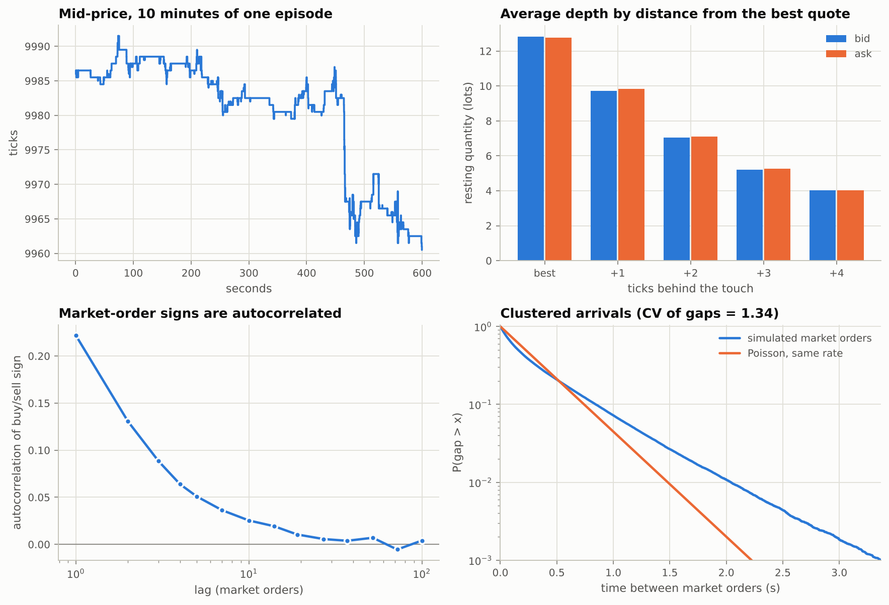
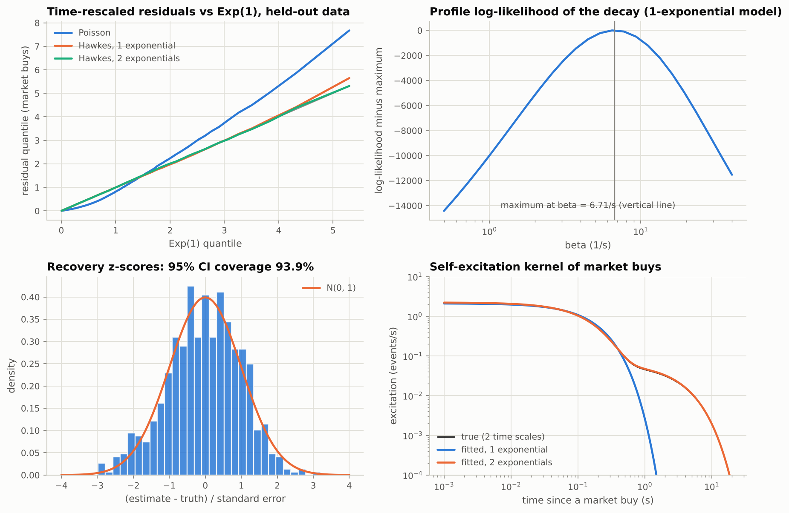
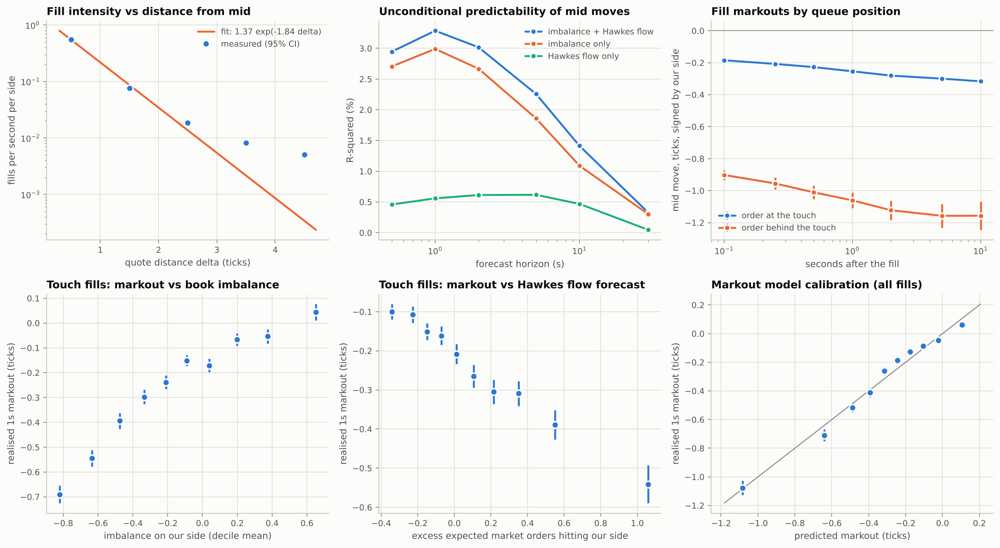
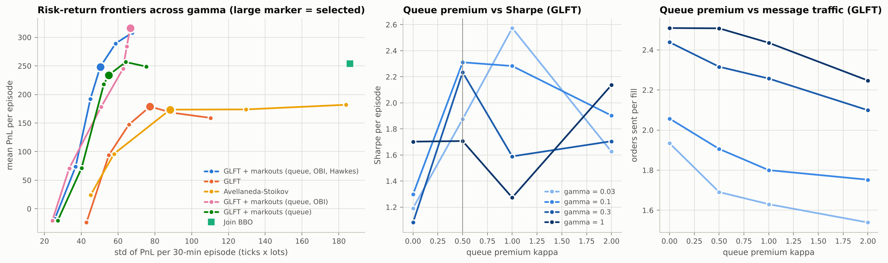
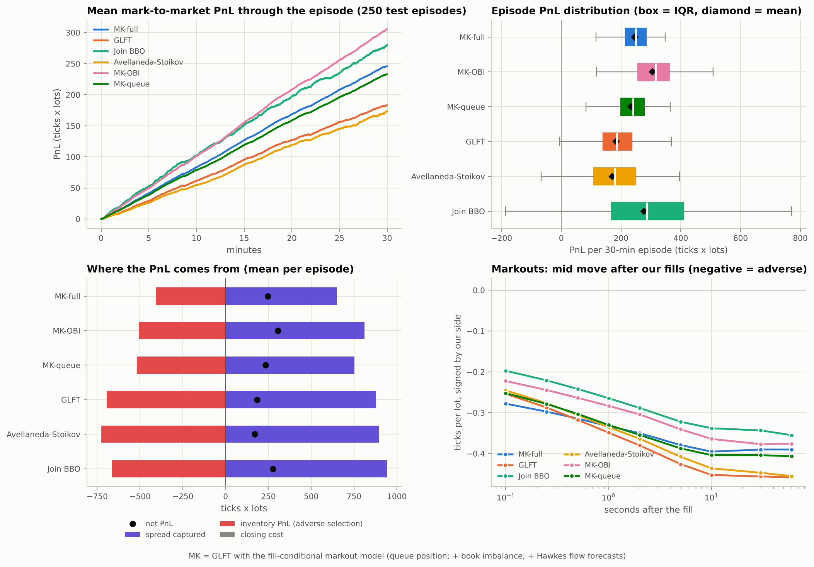
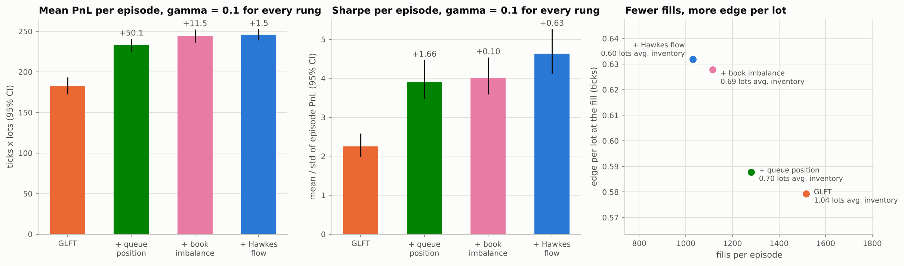
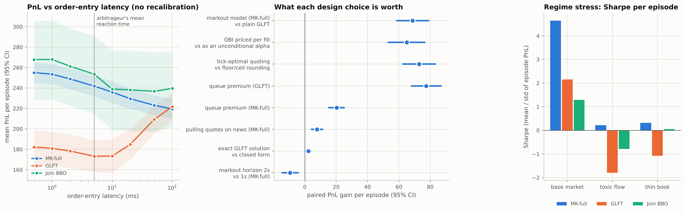

# Market making under adverse selection: a Hawkes-driven simulation study

*Research report for QuoteLab. Every number below is generated from `results/*.json` by
`experiments/08_tables.py`; every figure by the scripts in `experiments/`.*

## Abstract

I build a large-tick limit order book whose order flow follows a four-dimensional Hawkes process,
with zero-intelligence price placement, per-order cancellation, and public news that latency
arbitrageurs use to pick off stale quotes. On this market I estimate the order-flow model by maximum
likelihood, calibrate the inputs of the Avellaneda-Stoikov (AS) and Guéant-Lehalle-Fernandez-Tapia
(GLFT) market makers, and evaluate them out of sample. Textbook quotes are badly adversely selected:
a fill one tick behind the touch has lost 0.9 ticks within 0.1 s, because it happens only after a
market order has swept the whole best level. I keep GLFT's inventory value function but value each
candidate tick by the *expected markout of a fill there*, estimated from queue position, top-of-book
imbalance and Hawkes forecasts of the market orders about to arrive. On 250 held-out episodes this markout-aware strategy roughly doubles GLFT's Sharpe ratio (4.64 against 2.25), earns 63 more ticks per episode with about half the drawdown, and stays profitable under a toxic-flow stress test in which GLFT and a naive join-the-touch strategy lose heavily. Most of the gain comes from pricing queue position; book imbalance adds PnL, and the Hawkes forecast adds no PnL but removes risk. Two execution details, quoting the Hamiltonian-optimal tick and protecting queue priority, are each worth as much as the pricing model, and a latency sweep shows why a backtest that rewards being slow is missing a signal.

---

## 1. The simulated market

**Prices and time.** Prices are integer ticks; time is continuous. Each episode is 120 s of warm-up
followed by 30 minutes of trading.

**Order flow.** Four event types (market buy, market sell, limit buy, limit sell) arrive as a Hawkes
process with a two-time-scale kernel (decays 8/s and 0.35/s, weights 60/40). The branching matrix
encodes herding (market orders trigger market orders on the same side, 0.45) and liquidity
replenishment (a market buy triggers limit sells, 0.35). Spectral radius 0.56.

**Placement and cancellation.** A limit buy is placed $d$ ticks below the best ask with
$P(d) \propto d^{-1.2}$ on $\{1,\dots,10\}$, so it improves the bid whenever the spread is wider than
a tick (Bouchaud, Mézard & Potters 2002). Every resting order has an exponential lifetime (hazard
0.3/s), which makes depth mean-revert (Cont, Stoikov & Talreja 2010). Sizes are geometric (mean 3 lots
for market orders, 2 for limit orders).

**News and latency arbitrage.** Public news arrives at rate 0.05/s and moves the fair value by 1 or 2
ticks (probabilities 0.7 / 0.3). An arbitrageur reacts after an Exponential(mean 5 ms) delay and
sweeps every resting order priced on the wrong side of the new value. A market maker that sees the
news can cancel its exposed quotes, but only a cancel that arrives first counts.

**Common random numbers.** All of an episode's randomness is drawn before it starts, so every
strategy faces exactly the same market-order arrivals, placements, cancellation times and news.

<!-- BEGIN table:stylized -->
| Statistic | Value |
| :--- | ---: |
| Exogenous events per second | 23.4 |
| Market orders per second | 3.11 |
| Share of time the spread is 1 tick | 94.4% |
| Share of time the spread is 3+ ticks | 1.1% |
| Mean depth at best bid / ask (lots) | 12.8 / 12.8 |
| Volatility at 1 s / 300 s sampling (ticks per sqrt s) | 0.778 / 0.704 |
| Excess kurtosis of 1 s mid changes | 41.5 |
| Market-order sign autocorrelation, lags 1 / 10 | 0.222 / 0.025 |
| Coefficient of variation of market-order gaps (Poisson = 1) | 1.34 |
<!-- END table:stylized -->

*Figure 1. A large-tick market: the spread is one tick most of the time, depth decays away from the
touch, market-order signs are autocorrelated and arrivals are over-dispersed relative to Poisson.*

## 2. Learning the order flow

**Likelihood.** For decays $\beta$, $\lambda_i(t_n) = \mu_i + \sum_{j,k}\alpha_{ijk}R_{jk}(t_n)$ with
$R_{jk}$ the exponentially weighted counts of past type-j events, computable in O(N). The
log-likelihood is concave in $(\mu, \alpha)$ and separates by target type; each block is solved by an
EM warm start followed by projected Newton, and the decays are profiled out (Brent for one
exponential, a grid plus Nelder-Mead for two). Standard errors come from the observed information and
the curvature of the profile likelihood.

<!-- BEGIN table:hawkes_models -->
| Model | Parameters | Log-likelihood | BIC | Branching ratio | Decay rates (1/s) |
| :--- | ---: | ---: | ---: | ---: | ---: |
| Poisson | 4 | 961,763 | -1,923,470 | - | - |
| Hawkes, 1 exponential | 21 | 987,333 | -1,974,379 | 0.390 | 6.71 |
| Hawkes, 2 exponentials | 38 | 988,016 | -1,975,511 | 0.553 | 7.99, 0.354 |
| True data-generating process | 38 | 987,995 | -1,975,469 | 0.561 | 8, 0.35 |

899,444 training events. Lower BIC is better.
<!-- END table:hawkes_models -->

BIC selects the two-exponential kernel, and its estimated decays are within a few percent of the true
ones. The one-exponential fit is a textbook case of misspecification: unable to represent the slow
component, it pushes that activity into the baseline, and its branching ratio drops from 0.56 to 0.39.

<!-- BEGIN table:gof -->
| Model | Market buys | Market sells | Limit buys | Limit sells |
| :--- | ---: | ---: | ---: | ---: |
| Poisson | 0.1577 (p <0.001) | 0.1651 (p <0.001) | 0.0315 (p <0.001) | 0.0326 (p <0.001) |
| Hawkes, 1 exponential | 0.0045 (p 0.930) | 0.0128 (p 0.012) | 0.0046 (p 0.033) | 0.0026 (p 0.509) |
| Hawkes, 2 exponentials | 0.0058 (p 0.707) | 0.0114 (p 0.037) | 0.0037 (p 0.137) | 0.0026 (p 0.545) |

Kolmogorov-Smirnov statistic of time-rescaled inter-arrival times against Exp(1), on five held-out episodes. Estimator check: on 40 data sets simulated from known parameters, nominal 95% intervals covered the truth 93.9% of the time (z-scores: mean -0.03, sd 1.02).
<!-- END table:gof -->

*Figure 2. Time-rescaled residuals lie on the 45-degree line for both Hawkes fits and far from it for
Poisson; the fitted two-exponential kernel overlays the true one; recovery z-scores are close to
N(0, 1).*

## 3. Calibrating the market maker

**Fill intensity.** Probe strategies quote at fixed distances from the mid inside the simulator,
so queue priority, latency and the arbitrageur are all priced into the measured rates. A Poisson
likelihood for $\Lambda(\delta) = Ae^{-k\delta}$ is fitted on the operating range (the touch to two
ticks behind); deeper levels decay more slowly than an exponential.

<!-- BEGIN table:calibration -->
| Quantity | Value |
| :--- | ---: |
| Volatility sigma (ticks per sqrt s) | 0.778 |
| Fill intensity A (fills per s per side) | 1.375 |
| Fill decay k (per tick) | 1.845 |
| Measured fill rate at the touch / 1 / 2 ticks behind (per s) | 0.5515 / 0.0765 / 0.0186 |
| Inventory holding period by Little's law | 1.22 s |
| Markout horizon used by the strategies | 1 s |
<!-- END table:calibration -->

**Unconditional predictability.** Regressing future mid moves on top-of-book imbalance and the Hawkes
forecast of net market-order flow (Newey-West errors) gives an R-squared of about 3% at one second,
almost all from imbalance.

**Fill-conditional markouts.** What matters to a passive order is not the average future mid move but
the move *given that it was filled*. Regressing the markout of probe fills on the state at the time
of the fill:

<!-- BEGIN table:markout_models -->
| Model | At the touch | Behind the touch | Hawkes: flow at our side | Hawkes: flow at other side | Imbalance (own side) | R-squared |
| :--- | ---: | ---: | ---: | ---: | ---: | ---: |
| Queue position | -0.254 (-36.7) | -1.060 (-40.7) | - | - | - | 5.0% |
| + imbalance | -0.197 (-29.5) | -0.854 (-34.8) | - | - | +0.455 (+22.1) | 8.3% |
| + Hawkes flow | -0.163 (-24.7) | -0.793 (-34.2) | -0.257 (-5.8) | -0.007 (-0.2) | +0.417 (+18.5) | 9.2% |

OLS on 43,297 fills of probe quotes in training episodes; 1-second markouts in ticks; t-statistics clustered by episode in parentheses. Hawkes features are expected market orders over the horizon in excess of their stationary mean.
<!-- END table:markout_models -->

Three facts drive everything that follows. Queue position dominates: behind-the-touch fills are four
times as toxic as touch fills, because they require a sweep. Imbalance matters: a fill on the thin side
of the book is worse. And the Hawkes forecast of market orders arriving at our side adds a smaller
but clearly significant effect on top.

*Figure 3. Fill intensity; unconditional predictability by horizon; markouts by queue position; touch-fill
markouts against imbalance and the Hawkes flow forecast; calibration of the full markout model.*

## 4. Strategies

All strategies trade one lot per side with a hard inventory limit of ten lots and 5 ms order-entry
latency, see the market through a view that excludes their own orders, and cancel exposed quotes on
news.

* **Join BBO.** Always quote at the market's best bid and ask.
* **Avellaneda-Stoikov.** Inventory term $\eta = (q \pm \tfrac12)\gamma\sigma^2(T-t)$ and markup
  $\tfrac1\gamma\ln(1+\tfrac\gamma k)$.
* **GLFT.** The infinite-horizon closed form with inventory bounds,
  $\eta = (q \pm \tfrac12)c_2$, $c_2 = \sqrt{\tfrac{\gamma\sigma^2}{2kA}(1+\tfrac\gamma k)^{1+k/\gamma}}$.
* **Markout-aware GLFT ("MK").** GLFT's $\eta$, but each candidate tick (improve, join, one to three
  ticks behind) is valued with the HJB Hamiltonian
  $H(p) = Ae^{-k\delta}\big(1 - e^{-\gamma(\delta + M(p,x) - \eta)}\big)/\gamma$, where $M$ is the
  expected markout of a fill at $p$. The quote is withdrawn when no tick has $H > 0$. Three nested
  variants: queue position only (MK-queue), plus imbalance (MK-OBI), plus Hawkes flow (MK-full).

**Execution layer, shared by the model-based strategies.**
*Tick-constrained quoting:* the continuous optimum is mapped to the grid by maximising the same
Hamiltonian over feasible ticks rather than by rounding. *Queue premium:* a resting order keeps its
price unless a new price is better by a factor $(1+\kappa)$, because moving forfeits queue priority.

## 5. Experimental design

* **Seed discipline.** 20 training episodes estimate everything in sections 2 and 3; 60 validation
  episodes choose the queue premium (on GLFT) and then the risk aversion of each family by Sharpe
  ratio; 250 test episodes are run once at the end.
* **Inference.** Paired bootstrap confidence intervals and paired t-tests on per-episode PnL
  differences, Holm-Bonferroni across comparisons. Pairing on common random numbers removes most of the
  market noise from the comparisons.
* **Metric.** Sharpe ratio of episode PnL (per 30-minute episode, not annualised: the episodes are
  independent draws from a stationary simulator, which real days are not).

<!-- BEGIN table:validation -->
| Strategy | Selected gamma | Mean PnL | Std PnL | Sharpe |
| :--- | ---: | ---: | ---: | ---: |
| GLFT + markouts (queue, OBI, Hawkes) | 0.1 | 248.5 | 50.4 | 4.93 |
| GLFT + markouts (queue, OBI) | 0.01 | 316.2 | 66.6 | 4.75 |
| GLFT + markouts (queue) | 0.1 | 233.9 | 55.0 | 4.25 |
| GLFT | 0.1 | 178.7 | 77.3 | 2.31 |
| Avellaneda-Stoikov | 0.0003 | 173.4 | 88.3 | 1.96 |
| Join BBO | - | 253.8 | 186.1 | 1.36 |

60 validation episodes; queue premium kappa = 0.5 chosen first on GLFT; 46 configurations tried in total.
<!-- END table:validation -->

*Figure 4. Risk-return frontiers traced by risk aversion on validation data: the markout families lie
above GLFT and AS at every level of risk. Right: the queue premium raises Sharpe and cuts message traffic.*

## 6. Results on the test set

<!-- BEGIN table:test_compact -->
| Strategy | Sharpe per episode [95% CI] | Mean PnL [95% CI] | Std PnL | 5th pct PnL | Mean max drawdown | Mean abs inventory |
| :--- | ---: | ---: | ---: | ---: | ---: | ---: |
| GLFT + markouts (queue, OBI, Hawkes) | **4.64** [4.13, 5.26] | 246.0 [239.5, 252.6] | 53.1 | 150 | 40 | 0.60 |
| GLFT + markouts (queue, OBI) | 3.55 [3.19, 4.02] | 304.9 [294.3, 315.7] | 85.9 | 129 | 68 | 1.35 |
| GLFT + markouts (queue) | 3.91 [3.49, 4.47] | 233.0 [225.6, 240.5] | 59.6 | 131 | 49 | 0.70 |
| GLFT | 2.25 [1.99, 2.58] | 182.9 [172.8, 193.0] | 81.4 | 27 | 74 | 1.04 |
| Avellaneda-Stoikov | 1.52 [1.30, 1.79] | 170.5 [156.7, 184.5] | 112.3 | -10 | 95 | 1.66 |
| Join BBO | 1.34 [1.14, 1.57] | 276.8 [251.0, 302.6] | 206.9 | -57 | 164 | 5.27 |
<!-- END table:test_compact -->

<!-- BEGIN table:test_detail -->
| Strategy | Fills | Edge per lot | Markout 1 s | Realised spread 5 s | PnL per lot | Messages per fill | Lots sniped | Losing episodes |
| :--- | ---: | ---: | ---: | ---: | ---: | ---: | ---: | ---: |
| GLFT + markouts (queue, OBI, Hawkes) | 1,030 | 0.632 | -0.333 | 0.253 | 0.239 | 8.81 | 42.9 | 0.0% |
| GLFT + markouts (queue, OBI) | 1,340 | 0.606 | -0.283 | 0.265 | 0.228 | 4.39 | 47.1 | 0.0% |
| GLFT + markouts (queue) | 1,280 | 0.588 | -0.330 | 0.200 | 0.183 | 4.35 | 39.6 | 0.0% |
| GLFT | 1,515 | 0.579 | -0.349 | 0.153 | 0.121 | 2.83 | 45.7 | 2.4% |
| Avellaneda-Stoikov | 1,589 | 0.565 | -0.335 | 0.157 | 0.108 | 2.79 | 47.3 | 6.4% |
| Join BBO | 1,766 | 0.534 | -0.264 | 0.211 | 0.156 | 2.07 | 52.4 | 7.6% |

Per-lot quantities in ticks. PnL per lot is also the break-even maker fee.
<!-- END table:test_detail -->

**Paired comparisons against GLFT**

<!-- BEGIN table:paired_glft -->
| Strategy | PnL difference [95% CI] | t | p (Holm) | Episodes won | Variance removed by pairing |
| :--- | ---: | ---: | ---: | ---: | ---: |
| GLFT + markouts (queue, OBI, Hawkes) | +63.1 [+56.5, +69.8] | +18.5 | <0.001 | 90% | 69% |
| GLFT + markouts (queue, OBI) | +122.0 [+115.1, +128.9] | +34.6 | <0.001 | 98% | 78% |
| GLFT + markouts (queue) | +50.1 [+44.8, +55.4] | +18.7 | <0.001 | 90% | 82% |
| Avellaneda-Stoikov | -12.4 [-21.4, -3.0] | -2.6 | 0.009 | 45% | 71% |
| Join BBO | +93.8 [+69.7, +118.2] | +7.6 | <0.001 | 70% | 23% |
<!-- END table:paired_glft -->

**Paired comparisons against Join BBO**

<!-- BEGIN table:paired_join -->
| Strategy | PnL difference [95% CI] | t | p (Holm) | Episodes won | Variance removed by pairing |
| :--- | ---: | ---: | ---: | ---: | ---: |
| GLFT + markouts (queue, OBI, Hawkes) | -30.7 [-55.2, -6.2] | -2.5 | 0.028 | 40% | 16% |
| GLFT + markouts (queue, OBI) | +28.1 [+5.4, +51.0] | +2.4 | 0.028 | 55% | 34% |
| GLFT + markouts (queue) | -43.7 [-68.1, -19.2] | -3.5 | 0.002 | 40% | 17% |
| GLFT | -93.8 [-118.2, -69.7] | -7.6 | <0.001 | 30% | 23% |
| Avellaneda-Stoikov | -106.2 [-127.8, -84.7] | -9.7 | <0.001 | 24% | 46% |
<!-- END table:paired_join -->

**PnL attribution** (spread captured at the moment of the fill, minus inventory losses as the mid
moves, minus the cost of closing the position at the end):

<!-- BEGIN table:attribution -->
| Strategy | Spread captured | Inventory PnL | Closing cost | Net PnL |
| :--- | ---: | ---: | ---: | ---: |
| GLFT + markouts (queue, OBI, Hawkes) | 651.5 | -405.1 | -0.3 | 246.0 |
| GLFT + markouts (queue, OBI) | 812.2 | -506.5 | -0.8 | 304.9 |
| GLFT + markouts (queue) | 752.6 | -519.2 | -0.4 | 233.0 |
| GLFT | 878.1 | -694.5 | -0.6 | 182.9 |
| Avellaneda-Stoikov | 897.7 | -723.6 | -3.6 | 170.5 |
| Join BBO | 942.7 | -662.4 | -3.5 | 276.8 |
<!-- END table:attribution -->

**Fill quality by queue position:**

<!-- BEGIN table:fill_quality -->
| Strategy | Fill type | Share of volume | Edge per lot | Markout 5 s | Realised spread 5 s | Realised spread per episode |
| :--- | ---: | ---: | ---: | ---: | ---: | ---: |
| GLFT + markouts (queue, OBI, Hawkes) | improving the spread | 5.4% | 0.937 | -0.408 | 0.530 | 29.3 |
|  | at the touch | 85.6% | 0.555 | -0.265 | 0.290 | 253.8 |
|  | behind the touch | 4.8% | 1.694 | -1.904 | -0.210 | -10.4 |
|  | taken by the news arbitrageur | 4.2% | 0.591 | -0.949 | -0.357 | -15.1 |
| GLFT | improving the spread | 6.2% | 0.688 | -0.534 | 0.153 | 14.3 |
|  | at the touch | 87.2% | 0.534 | -0.332 | 0.201 | 264.6 |
|  | behind the touch | 3.5% | 1.517 | -2.172 | -0.655 | -35.0 |
|  | taken by the news arbitrageur | 3.0% | 0.597 | -0.973 | -0.375 | -17.2 |
| Join BBO | improving the spread | 0.2% | 0.702 | -0.889 | -0.187 | -0.7 |
|  | at the touch | 96.6% | 0.531 | -0.304 | 0.227 | 384.3 |
|  | behind the touch | 0.3% | 1.892 | -1.535 | 0.357 | 1.6 |
|  | taken by the news arbitrageur | 3.0% | 0.513 | -0.795 | -0.282 | -14.8 |

First 100 test episodes. Position is measured against the market's best price on our side just before the trade, excluding our own orders. Per-lot quantities in ticks.
<!-- END table:fill_quality -->

*Figure 5. Test-set equity curves, PnL distributions, attribution and markout curves.*

The recommended strategy, MK-full, roughly doubles GLFT's Sharpe ratio (4.64 against 2.25) and earns
63 more ticks per episode, with about half the drawdown, less inventory, and no losing episode out of 250. It
gets there by trading less and better: 1,030 fills instead of 1,515, a higher edge per lot (0.63 against
0.58 ticks) and a 5-second realised spread of 0.25 ticks per lot against 0.15. Its inventory losses fall
from 695 to 405 ticks per episode while the spread it captures falls by less (878 to 651). The price is
message traffic: it withdraws and re-posts quotes as the book turns against it, sending 8.8 messages
per fill against 2.8 for GLFT. On a venue that charges per message or caps order-to-trade ratios that
cost would have to enter the objective.

The fill-quality table shows how. The markout model does not avoid adverse selection on average: its
1-second markout (-0.33 ticks per lot) is close to GLFT's (-0.35) and worse than Join BBO's (-0.26),
which almost never quotes behind the touch. What it does is choose its fills. Its fills at the touch
realise 0.29 ticks per lot against 0.20 for GLFT, its spread-improving fills 0.53 against 0.15, and
its fills behind the touch lose 0.21 per lot instead of 0.66. It improves the spread or sits behind
the touch only when the extra edge pays for the extra toxicity.

MK-OBI, tuned to a lower risk aversion on validation, has the highest mean PnL (305) with more
inventory and a Sharpe ratio of 3.55. Join BBO earns the spread by warehousing risk: its mean PnL is
high, but its standard deviation is four times MK-full's, it holds 5.3 lots on average and it loses
money in 7.6% of episodes. Avellaneda-Stoikov trails GLFT because its inventory penalty is proportional
to the time left: its average inventory climbs from 0.7 lots in the first five minutes to 4.3 in the
last five, exactly when the closing cost bites.

## 7. Where the gain comes from

The test comparison lets each family choose its own risk aversion on validation data (GLFT and MK-full
both chose 0.1, MK-OBI chose 0.01), which can mix better pricing with a different appetite for risk.
Holding the risk aversion and the queue premium fixed and adding one layer of the markout model at a
time isolates each layer:

<!-- BEGIN table:ladder -->
| Model (gamma = 0.1) | Sharpe [95% CI] | Sharpe gain | Mean PnL [95% CI] | PnL gain | Fills | Markout 1 s | Mean abs inventory |
| :--- | ---: | ---: | ---: | ---: | ---: | ---: | ---: |
| GLFT | 2.25 [1.99, 2.58] | - | 182.9 [172.8, 193.0] | - | 1,515 | -0.349 | 1.04 |
| + queue position | 3.91 [3.49, 4.47] | +1.66 [+1.37, +2.02] | 233.0 [225.6, 240.5] | +50.1 [+44.8, +55.4] | 1,280 | -0.330 | 0.70 |
| + book imbalance | 4.01 [3.60, 4.53] | +0.10 [-0.22, +0.40] | 244.5 [236.9, 252.1] | +11.5 [+7.3, +15.7] | 1,115 | -0.336 | 0.69 |
| + Hawkes flow | 4.64 [4.13, 5.26] | +0.63 [+0.32, +0.98] | 246.0 [239.5, 252.6] | +1.5 [-2.0, +5.2] | 1,030 | -0.333 | 0.60 |

All rungs on the same 250 test episodes, same risk aversion and queue premium; gains are paired differences with bootstrap CIs.
<!-- END table:ladder -->

Pricing queue position is the big step: it stops GLFT from resting orders behind the touch that only fill after a sweep, worth 50 ticks and 1.66 of Sharpe per episode. Book imbalance adds a further 11.5 ticks of mean PnL but no significant Sharpe. The Hawkes flow forecast adds no mean PnL (+1.5, CI -2.0 to +5.2) but lowers risk: the strategy trades less in bursts (1,030 fills against 1,115), carries less inventory (0.60 against 0.69 lots) and has a fifth less drawdown, so its Sharpe rises by 0.63 (CI 0.32 to 0.98). Across the whole ladder the markouts per lot barely move; what changes is *which* fills the strategy accepts and at what price (edge per lot rises from 0.58 to 0.63 ticks).

## 8. Robustness

<!-- BEGIN table:ablations -->
| Comparison | PnL gain per episode [95% CI] | t | p | Episodes won |
| :--- | ---: | ---: | ---: | ---: |
| Markout model (MK-full) vs plain GLFT | +68.7 [+58.5, +79.1] | +12.9 | <0.001 | 89% |
| Imbalance priced per fill vs used as an unconditional alpha | +65.0 [+53.1, +76.6] | +10.7 | <0.001 | 88% |
| Tick-optimal quoting vs floor/ceil rounding (GLFT) | +72.9 [+62.5, +83.2] | +13.6 | <0.001 | 91% |
| Queue premium vs none (GLFT) | +77.4 [+68.1, +86.9] | +16.2 | <0.001 | 95% |
| Queue premium vs none (MK-full) | +20.2 [+15.3, +25.2] | +7.9 | <0.001 | 76% |
| Pulling quotes on news vs ignoring news (MK-full) | +7.8 [+4.2, +11.4] | +4.3 | <0.001 | 68% |
| Exact GLFT solution vs closed form | +2.2 [+0.7, +4.0] | +2.7 | 0.008 | 29% |
| Markout horizon 2 s vs 1 s (MK-full) | -9.4 [-14.5, -4.3] | -3.6 | <0.001 | 35% |

Paired on the first 100 test episodes.
<!-- END table:ablations -->

**Latency.**

<!-- BEGIN table:latency -->
| Order-entry latency | GLFT + markouts (queue, OBI, Hawkes) | GLFT | Join BBO |
| :--- | ---: | ---: | ---: |
| 0.5 ms | 255.0 (6) | 182.2 (6) | 267.8 (7) |
| 1 ms | 253.5 (12) | 180.9 (13) | 267.9 (15) |
| 2 ms | 248.8 (22) | 178.3 (24) | 261.2 (27) |
| 5 ms | 241.9 (43) | 173.2 (46) | 253.5 (52) |
| 10 ms | 235.9 (58) | 173.4 (62) | 238.9 (71) |
| 20 ms | 229.5 (66) | 184.8 (70) | 238.1 (80) |
| 50 ms | 223.1 (66) | 209.3 (70) | 236.8 (80) |
| 100 ms | 219.5 (65) | 221.7 (69) | 239.6 (79) |

Mean PnL per episode; in parentheses, lots per episode taken by the news arbitrageur, whose reaction time is Exponential with mean 5 ms. No recalibration across latencies.
<!-- END table:latency -->

**Regime stress.**

<!-- BEGIN table:stress -->
| Market | GLFT + markouts (queue, OBI, Hawkes) | GLFT | Join BBO |
| :--- | ---: | ---: | ---: |
| Base market (branching ratio 0.56) | 4.64 (241.9) | 2.15 (173.2) | 1.29 (253.5) |
| Toxic flow (branching ratio 0.68) | 0.22 (39.9) | -1.80 (-508.2) | -0.79 (-326.9) |
| Thin book (branching ratio 0.56) | 0.32 (38.5) | -1.07 (-176.7) | 0.05 (14.3) |

Sharpe per episode (mean PnL). Strategies keep their base-market calibration. Toxic flow: market-order self-excitation up by a third. Thin book: 25% fewer limit orders.
<!-- END table:stress -->

**Ablations.** Every element of the design earns its place, and the two execution details are worth as
much as the pricing model: quoting the tick that maximises the Hamiltonian instead of rounding the
continuous quote away from the mid adds 73 ticks per episode to GLFT, and the queue premium adds 77
(and 20 to MK-full, with 36% fewer orders). Pricing book imbalance per fill rather than using it as an
unconditional alpha adds 65 ticks at the same risk aversion. Pulling quotes on news is worth 8 ticks at
5 ms latency. The exact GLFT solution adds a statistically significant but economically small 2 ticks
over the closed form. A 2-second markout horizon earns 9 ticks less per episode than the 1-second
horizon chosen by Little's law, at the same Sharpe ratio.

**Latency.** Latency has two effects with opposite signs. The intended one is the race: as latency
rises from 0.5 to 100 ms, the lots MK-full loses to the news arbitrageur rise from 6 to 65 per episode
and its mean PnL falls monotonically from 255 to 220. The second effect is a trap: a slow market maker
is also absent from the book in the hundred milliseconds after a price move, exactly when fills are
most toxic. GLFT benefits from that accidental protection: its PnL rises from 173 at 10 ms to 222 at
100 ms. MK-full already avoids those fills on purpose, so latency is a pure cost to it. A backtest in
which slower looks better is a sign that the strategy is missing a signal.

**Regime stress.** Without any recalibration, a market with a third more market-order self-excitation
(branching ratio 0.68 instead of 0.56) turns GLFT and Join BBO into heavy losers (-508 and -327 ticks
per episode) while MK-full stays profitable (+40). The same holds for a thinner book with 25% fewer
limit orders (MK-full +39, GLFT -177, Join BBO +14). The markout model reads toxicity from the book in
real time, through queue position and imbalance, so part of its protection does not depend on the
calibrated coefficients being right.

## 9. Discussion and limitations

Three lessons generalise beyond this simulator. First, the textbook market-making models price the mid-price, but a passive order's fills are a selected sample: conditioning on the fill (queue position first, then the state of the book and of the flow) is where most of the value is, and it is cheap to estimate from one's own fills. Second, on a large-tick book the execution details are not details: choosing the right tick and not giving up queue priority were each worth as much as the pricing model. Third, a sophisticated signal can be statistically strong and economically modest. The Hawkes forecast is highly significant in the markout regression, yet it adds no mean PnL once queue position and imbalance are priced; its value shows up as lower risk. Used as a directional alpha during development it even lost money, because its jumps made the quotes flicker and give up priority.

**Limitations.**

* *A simulated market.* Zero-intelligence flow with Hawkes clustering and one strategic agent type.
  No competing market makers fighting for queue position, no hidden or iceberg orders, no auctions or
  intraday seasonality, stationary parameters.
* *Same model for calibration and evaluation.* Out-of-sample means new draws from the same
  data-generating process; model risk is understated. The stress tests are a partial check.
* *Heuristics.* The queue premium stands in for an explicit model of queue-position value
  (Moallemi & Yuan); the markout model is linear and prices only the filled unit, not the conditional
  revaluation of existing inventory.
* *Execution.* Fixed latency without jitter, no market-data latency, one lot per quote, no fees or
  rebates (the break-even maker fee is reported instead).

**Next steps.** Replay real L3 data with queue reconstruction; learn the quoting policy with
reinforcement learning, using the GLFT value function as a baseline; hedge inventory in a correlated
instrument; model queue-position value explicitly; move the matching engine to compiled code.

## References

See the [README](../README.md#references).
